# System design

Generated by `make graph` (`tools/graph/build.py`) from the code at the pinned commits; do not edit by hand. Open [`index.html`](index.html) in a browser for the zoomable version, where every box links to its source and the walkthroughs highlight each step.

```mermaid
flowchart TD
  subgraph sys_umbrella["Dev workflow"]
    grp_dev_reset[["make reset<br/>nuke → up → seed → smoke"]]:::tool
    script_seed_seed_sh[["seed/seed.sh"]]:::tool
  end
  subgraph sys_fdb["fdb tooling"]
    grp_fdb_cli[["fdb CLI<br/>tools/cli/fdb"]]:::tool
    grp_fdb_core["fdb core<br/>import · put · status"]:::code
    subgraph svc_fdb_api["fdb-api"]
      direction TB
      grp_fdb_http["HTTP API<br/>/import · /repos/…/contents · /pipeline"]:::fn
    end
  end
  subgraph sys_wacs["WACS"]
    svc_wacs("wacs<br/>built here"):::svc
    svc_wacs_db[("wacs-db<br/>mariadb:10.11")]:::store
    svc_wacs_redis[("wacs-redis<br/>valkey:7.2")]:::store
  end
  subgraph sys_srp["ScriptureRenderingPipeline"]
    svc_BTTWriterCatalog("BTTWriterCatalog<br/>production only"):::inactive
    svc_VerseReportingProcessor("VerseReportingProcessor<br/>production only"):::inactive
    subgraph svc_srp_webhook["srp-webhook"]
      direction TB
      fn_srp_MergeWebhook["MergeWebhook<br/>HTTP /merge"]:::fn
      fn_srp_Webhook["Webhook<br/>HTTP /webhook"]:::fn
      grp_srp_http["On-demand HTTP<br/>RenderDoc · CheckRepoExists · (Un)RegisterWebhook"]:::fn
    end
    subgraph svc_srp_worker["srp-worker"]
      direction TB
      fn_srp_MergeTrigger["MergeTrigger<br/>Service Bus trigger"]:::fn
      fn_srp_ProgressReporting["ProgressReporting<br/>Service Bus trigger"]:::fn
      fn_srp_RenderingTrigger["RenderingTrigger<br/>Service Bus trigger"]:::fn
      fn_srp_RepoAnalysisTrigger["RepoAnalysisTrigger<br/>Service Bus trigger"]:::fn
      grp_srp_dispatch["WebhookDispatcher<br/>Service Bus trigger ×2"]:::fn
      grp_srp_renderers["Renderers<br/>Bible · tN · tQ · tW · tA · commentary"]:::fn
    end
  end
  subgraph sys_infra["Azure emulation"]
    subgraph svc_azurite["azurite"]
      direction TB
      blob__web[("$web<br/>blob container")]:::store
      blob_template[("template<br/>blob container")]:::store
    end
    subgraph svc_servicebus["servicebus"]
      direction TB
      topic_audiobiel{{"audiobiel<br/>topic"}}:::topic
      topic_mergedresult{{"mergedresult<br/>topic"}}:::topic
      topic_mergerequest{{"mergerequest<br/>topic"}}:::topic
      topic_repoanalysisresult{{"repoanalysisresult<br/>topic"}}:::topic
      topic_reporendered{{"reporendered<br/>topic"}}:::topic
      topic_versecountingresult{{"versecountingresult<br/>topic"}}:::topic
      topic_wacsevent{{"wacsevent<br/>topic"}}:::topic
    end
  end
  subgraph sys_languageapi["languageapi"]
    subgraph svc_lapi_controller["lapi-controller"]
      direction TB
      fn_lapi_waAudioRenderings["waAudioRenderings<br/>Service Bus trigger"]:::fn
      fn_lapi_waLangApiGitTopics["waLangApiGitTopics<br/>Service Bus trigger"]:::fn
      fn_lapi_waLangApiRenderings["waLangApiRenderings<br/>Service Bus trigger"]:::fn
      grp_lapi_routes["REST routes<br/>/api/language · content · git · rendering …"]:::fn
      grp_lapi_timers["Timers<br/>localizations · GL USFM sources"]:::fn
    end
    svc_lapi_hasura("lapi-hasura<br/>graphql-engine:v2.30.1.cli-m"):::svc
    svc_lapi_migrate("lapi-migrate<br/>built here"):::svc
    svc_lapi_postgres[("lapi-postgres<br/>postgres:15.7")]:::store
  end

  blob_template -->|"print.html"| fn_srp_RenderingTrigger
  fn_lapi_waAudioRenderings -->|"reuses handler"| grp_lapi_routes
  fn_lapi_waAudioRenderings -->|"reads/writes"| svc_lapi_postgres
  fn_lapi_waLangApiGitTopics -->|"reads/writes"| svc_lapi_postgres
  fn_lapi_waLangApiRenderings -->|"reuses handler"| grp_lapi_routes
  fn_srp_MergeTrigger -->|"publishes to"| topic_mergedresult
  fn_srp_MergeWebhook -->|"publishes to"| topic_mergerequest
  fn_srp_ProgressReporting -->|"publishes to"| topic_versecountingresult
  fn_srp_RenderingTrigger -->|"writes HTML, index.json, build_log.json"| blob__web
  fn_srp_RenderingTrigger -->|"renders with"| grp_srp_renderers
  fn_srp_RenderingTrigger -->|"publishes to"| topic_reporendered
  fn_srp_RepoAnalysisTrigger -->|"publishes to"| topic_repoanalysisresult
  fn_srp_Webhook -->|"publishes to"| topic_wacsevent
  grp_dev_reset -->|"runs"| script_seed_seed_sh
  grp_fdb_core -->|"reads build_log.json"| blob__web
  grp_fdb_core -->|"GraphQL rendered_content"| svc_lapi_hasura
  grp_fdb_core -->|"Gitea REST + git push"| svc_wacs
  grp_fdb_http -->|"same operations"| grp_fdb_core
  grp_lapi_routes -->|"reads/writes"| svc_lapi_postgres
  grp_lapi_timers -->|"reads/writes"| svc_lapi_postgres
  script_seed_seed_sh -->|"creates containers"| blob__web
  script_seed_seed_sh -->|"creates container"| blob_template
  script_seed_seed_sh -->|"reference data"| svc_lapi_controller
  script_seed_seed_sh -->|"admin user, webhook, demo repo"| svc_wacs
  script_seed_seed_sh -->|"token trigger SQL"| svc_wacs_db
  svc_lapi_hasura -->|"reads"| svc_lapi_postgres
  svc_lapi_migrate -->|"applies drizzle/*.sql"| svc_lapi_postgres
  svc_wacs -.->|"links to rendered pages"| blob__web
  svc_wacs -->|"repo zip"| fn_srp_RenderingTrigger
  svc_wacs -->|"system webhook (push, create, repository)"| fn_srp_Webhook
  svc_wacs -.->|"repo listings (API)"| grp_lapi_timers
  topic_audiobiel -->|"languageapi"| fn_lapi_waAudioRenderings
  topic_mergedresult -->|"NotificationHandler"| svc_VerseReportingProcessor
  topic_mergerequest -->|"MergeRequest"| fn_srp_MergeTrigger
  topic_repoanalysisresult -->|"WebhookDispatcher"| grp_srp_dispatch
  topic_reporendered -->|"reporendered-languageapi"| fn_lapi_waLangApiRenderings
  topic_versecountingresult -->|"InternalProcessor: user.success=true"| svc_VerseReportingProcessor
  topic_wacsevent -->|"languageapi"| fn_lapi_waLangApiGitTopics
  topic_wacsevent -->|"VerseCounting: push/fork/create"| fn_srp_ProgressReporting
  topic_wacsevent -->|"RenderingWebhook: push/fork/create"| fn_srp_RenderingTrigger
  topic_wacsevent -->|"RepoAnalysis"| fn_srp_RepoAnalysisTrigger
  topic_wacsevent -->|"WebhookDispatcher"| grp_srp_dispatch
  topic_wacsevent -->|"InternalProcessor: repo deleted"| svc_VerseReportingProcessor

  classDef svc fill:#dbeafe,stroke:#1d4ed8,color:#0b1b3a,stroke-width:1.5px
  classDef fn fill:#ede9fe,stroke:#6d28d9,color:#1e1033,stroke-width:1.5px
  classDef topic fill:#ffedd5,stroke:#c2410c,color:#3a1606,stroke-width:1.5px
  classDef store fill:#dcfce7,stroke:#15803d,color:#062612,stroke-width:1.5px
  classDef code fill:#e0f2fe,stroke:#0369a1,color:#082032,stroke-width:1.5px
  classDef tool fill:#f1f5f9,stroke:#475569,color:#0f172a,stroke-width:1.5px
  classDef inactive fill:#f8fafc,stroke:#94a3b8,color:#64748b,stroke-width:1.5px,stroke-dasharray:5 4
  style sys_umbrella fill:#fafaf9,stroke:#d6d3d1,color:#44403c
  style sys_fdb fill:#fafaf9,stroke:#d6d3d1,color:#44403c
  style sys_wacs fill:#fafaf9,stroke:#d6d3d1,color:#44403c
  style sys_srp fill:#fafaf9,stroke:#d6d3d1,color:#44403c
  style sys_infra fill:#fafaf9,stroke:#d6d3d1,color:#44403c
  style sys_languageapi fill:#fafaf9,stroke:#d6d3d1,color:#44403c
  style svc_azurite fill:#f5f9ff,stroke:#93c5fd,color:#1e3a8a,stroke-width:1.5px
  style svc_fdb_api fill:#f5f9ff,stroke:#93c5fd,color:#1e3a8a,stroke-width:1.5px
  style svc_lapi_controller fill:#f5f9ff,stroke:#93c5fd,color:#1e3a8a,stroke-width:1.5px
  style svc_servicebus fill:#f5f9ff,stroke:#93c5fd,color:#1e3a8a,stroke-width:1.5px
  style svc_srp_webhook fill:#f5f9ff,stroke:#93c5fd,color:#1e3a8a,stroke-width:1.5px
  style svc_srp_worker fill:#f5f9ff,stroke:#93c5fd,color:#1e3a8a,stroke-width:1.5px
```

**Legend:** blue rounded boxes are containers, purple boxes are functions or routes, orange hexagons are Service Bus topics, green cylinders are data stores, grey boxes are dev tooling, and dashed boxes run in production only. Solid arrows are calls and messages; dashed arrows are connections set up in config. An arrow from a topic is labelled with its subscription and filter.

## Full graph

The diagram groups things to stay readable. [`graph.json`](graph.json) has every item it was drawn from: **154 nodes, 237 edges.** 3 blob, 7 endpoint, 16 file, 24 function, 20 make, 12 module, 5 script, 17 service, 12 subscription, 6 system, 19 table, 7 topic, 6 volume.

Pinned submodules:

- `repos/wacs` @ [`00b31b5376`](https://github.com/WycliffeAssociates/WACS/tree/00b31b5376408f054396b7251b03a1b64574fb00) (tracks `prod`)
- `repos/srp` @ [`d5255debf3`](https://github.com/WycliffeAssociates/ScriptureRenderingPipeline/tree/d5255debf3bfade4ce1be9d4df37f77a18407f0f) (tracks `master`)
- `repos/languageapi` @ [`0cae62328d`](https://github.com/WycliffeAssociates/languageapi/tree/0cae62328df6abb9541ee49d308c84e132bfe6bb) (tracks `prod`)

## Most connected

Hubs: start reading here. Startup-order (`depends_on`) edges are not counted.

| Node | Kind | System | Connections |
|---|---|---|---|
| `lapi-hasura` | service | languageapi | 26 |
| `wacs` | service | WACS | 16 |
| `fdb-api` | service | fdb tooling | 14 |
| `seed/seed.sh` | script | Dev workflow | 13 |
| `RenderingTrigger` | function | ScriptureRenderingPipeline | 11 |
| `language` | table | languageapi | 10 |
| `content` | table | languageapi | 9 |
| `populateGlUsfmSources` | function | languageapi | 8 |
| `fdb.core` | module | fdb tooling | 8 |
| `scripts/smoke.sh` | script | Dev workflow | 8 |
| `azurite` | service | Azure emulation | 8 |
| `git_repo` | table | languageapi | 8 |

## Seams between systems

Edges that cross from one system to another. These are the contracts a change can break.

| From | | To | Evidence |
|---|---|---|---|
| `InternalProcessor` (Azure emulation) | triggers | `VerseReportingProcessor` (ScriptureRenderingPipeline) | repos/srp/VerseReportingProcessor/VerseCounterService.cs:28 |
| `MergeRequest` (Azure emulation) | triggers | `MergeTrigger` (ScriptureRenderingPipeline) | repos/srp/ScriptureRenderingPipelineWorker/MergeHandler.cs:46 |
| `MergeTrigger` (ScriptureRenderingPipeline) | publishes | `mergedresult` (Azure emulation) | repos/srp/ScriptureRenderingPipelineWorker/MergeHandler.cs:47 |
| `MergeWebhook` (ScriptureRenderingPipeline) | publishes | `mergerequest` (Azure emulation) | repos/srp/ScriptureRenderingPipeline/Webhook.cs:138 |
| `NotificationHandler` (Azure emulation) | triggers | `VerseReportingProcessor` (ScriptureRenderingPipeline) | repos/srp/VerseReportingProcessor/MergeCompletedNotificationService.cs:22 |
| `ProgressReporting` (ScriptureRenderingPipeline) | publishes | `versecountingresult` (Azure emulation) | repos/srp/ScriptureRenderingPipelineWorker/ProgressReporting.cs:30 |
| `RenderingTrigger` (ScriptureRenderingPipeline) | calls (downloads repo zip) | `wacs` (WACS) | Gitea__localhost__BaseUrl=http://wacs:3000 in compose/srp.yaml; credentials keyed by the h |
| `RenderingTrigger` (ScriptureRenderingPipeline) | calls (reads print.html) | `template` (Azure emulation) | ScripturePipelineStorageTemplateContainer=template |
| `RenderingTrigger` (ScriptureRenderingPipeline) | calls (writes HTML, index.json, build_log.json) | `$web` (Azure emulation) | ScripturePipelineStorageOutputContainer=$web |
| `RenderingTrigger` (ScriptureRenderingPipeline) | publishes | `reporendered` (Azure emulation) | repos/srp/ScriptureRenderingPipelineWorker/RenderingTrigger.cs:56 |
| `RenderingWebhook` (Azure emulation) | triggers | `RenderingTrigger` (ScriptureRenderingPipeline) | repos/srp/ScriptureRenderingPipelineWorker/RenderingTrigger.cs:44 |
| `RepoAnalysisTrigger` (ScriptureRenderingPipeline) | publishes | `repoanalysisresult` (Azure emulation) | repos/srp/ScriptureRenderingPipelineWorker/RepoAnalysisTrigger.cs:46 |
| `RepoAnalysis` (Azure emulation) | triggers | `RepoAnalysisTrigger` (ScriptureRenderingPipeline) | repos/srp/ScriptureRenderingPipelineWorker/RepoAnalysisTrigger.cs:31 |
| `VerseCounting` (Azure emulation) | triggers | `ProgressReporting` (ScriptureRenderingPipeline) | repos/srp/ScriptureRenderingPipelineWorker/ProgressReporting.cs:29 |
| `WebhookDispatcher` (Azure emulation) | triggers | `WebhookDispatcherRepoAnalysisResultTrigger` (ScriptureRenderingPipeline) | repos/srp/ScriptureRenderingPipelineWorker/WebhookDispatcherTrigger.cs:69 |
| `WebhookDispatcher` (Azure emulation) | triggers | `WebhookDispatcherWACSMessageTrigger` (ScriptureRenderingPipeline) | repos/srp/ScriptureRenderingPipelineWorker/WebhookDispatcherTrigger.cs:27 |
| `Webhook` (ScriptureRenderingPipeline) | publishes | `wacsevent` (Azure emulation) | repos/srp/ScriptureRenderingPipeline/Webhook.cs:112 |
| `fdb-api` (fdb tooling) | uses | `$web` (Azure emulation) | FDB_BLOB_URL=http://azurite:10000/devstoreaccount1/$web |
| `fdb-api` (fdb tooling) | uses | `azurite` (Azure emulation) | FDB_BLOB_URL=http://azurite:10000/devstoreaccount1/$web |
| `fdb-api` (fdb tooling) | uses | `lapi-hasura` (languageapi) | FDB_HASURA_URL=http://lapi-hasura:8080 |
| `fdb-api` (fdb tooling) | uses | `wacs` (WACS) | FDB_WACS_URL=http://wacs:3000 |
| `fdb.clients` (fdb tooling) | calls (Gitea REST + git push) | `wacs` (WACS) | tools/fdb/clients.py: Gitea and git(); pushes are refused unless the host is local (config |
| `fdb.clients` (fdb tooling) | calls (GraphQL rendered_content) | `lapi-hasura` (languageapi) | tools/fdb/clients.py: Hasura.query, used by core._status_once for the languageapi stage |
| `fdb.clients` (fdb tooling) | calls (reads build_log.json) | `$web` (Azure emulation) | tools/fdb/clients.py: Blob.get_json, used by core._status_once for the render stage |
| `languageapi` (Azure emulation) | triggers | `waAudioRenderings` (languageapi) | repos/languageapi/controller/src/functions/audio-renderings-bus.ts:240 |
| `languageapi` (Azure emulation) | triggers | `waLangApiGitTopics` (languageapi) | repos/languageapi/controller/src/functions/bus-wacsevent-gitTopics.ts:128 |
| `lapi-controller` (languageapi) | uses | `azurite` (Azure emulation) | AzureWebJobsStorage=DefaultEndpointsProtocol=http;AccountName=devstoreaccount1;AccountKey= |
| `lapi-controller` (languageapi) | uses | `servicebus` (Azure emulation) | BUS_CONN=Endpoint=sb://servicebus;SharedAccessKeyName=RootManageSharedAccessKey;SharedAcce |
| `lapi-controller` (languageapi) | uses | `wacs` (WACS) | WACS_API_URL=http://wacs:3000/api/v1 |
| `populateGlUsfmSources` (languageapi) | uses | `wacs` (WACS) | repos/languageapi/controller/src/functions/glUsfmSources.ts reads WACS_API_URL=http://wacs |
| `reporendered-languageapi` (Azure emulation) | triggers | `waLangApiRenderings` (languageapi) | repos/languageapi/controller/src/functions/renderings-bus.ts:266 |
| `srp-webhook` (ScriptureRenderingPipeline) | uses | `azurite` (Azure emulation) | AzureWebJobsStorage=DefaultEndpointsProtocol=http;AccountName=devstoreaccount1;AccountKey= |
| `srp-webhook` (ScriptureRenderingPipeline) | uses | `servicebus` (Azure emulation) | ServiceBusConnectionString=Endpoint=sb://servicebus;SharedAccessKeyName=RootManageSharedAc |
| `srp-worker` (ScriptureRenderingPipeline) | uses | `$web` (Azure emulation) | ScripturePipelineStorageOutputContainer=$web |
| `srp-worker` (ScriptureRenderingPipeline) | uses | `azurite` (Azure emulation) | AzureWebJobsStorage=DefaultEndpointsProtocol=http;AccountName=devstoreaccount1;AccountKey= |
| `srp-worker` (ScriptureRenderingPipeline) | uses | `servicebus` (Azure emulation) | ServiceBusConnectionString=Endpoint=sb://servicebus;SharedAccessKeyName=RootManageSharedAc |
| `srp-worker` (ScriptureRenderingPipeline) | uses | `template` (Azure emulation) | ScripturePipelineStorageTemplateContainer=template |
| `srp-worker` (ScriptureRenderingPipeline) | uses | `wacs` (WACS) | GiteaBaseAddress=http://wacs:3000 |
| `tools/test.sh` (fdb tooling) | calls | `azurite` (Azure emulation) | tools/test.sh:47 |
| `wacs` (WACS) | calls (system webhook (push, create, repository)) | `Webhook` (ScriptureRenderingPipeline) | seed/seed.sh registers a Gitea system hook to SRP_HOOK_URL=http://srp-webhook/webhook (scr |
| `wacs` (WACS) | uses | `$web` (Azure emulation) | READER_BASE_LINK=http://localhost:10000/devstoreaccount1/$web/u/ |

## Known gaps and notes

- **`source_zips`** (table): Tracked by Hasura; not declared in the Drizzle schema (created by raw SQL migrations or a later rename).
- **`vw_consolidated_repos`** (table): View is tracked by Hasura but no migration creates it, so Hasura marks it inconsistent.
- **`vw_langnames`** (table): Created by a migration (raw SQL), not declared in the Drizzle schema.

## Deployed in production, not run locally

- `BTTWriterCatalog`: Builds the BTT Writer, BIEL and unfoldingWord catalogs from Cosmos DB change-feed triggers. It runs in production but not here, because it needs Cosmos DB.
- `VerseReportingProcessor`: Consumes verse-counting results and merge notifications and reports them to PORT/Dataverse. It runs in production but not here: it needs a SQL Server stored procedure that isn't in the repo, plus PORT/Dataverse.

## Tours

### A commit's journey

What happens between `git push` and the change showing up in the public API. This is the flow the whole repo exists to reproduce, and what `make smoke` and `fdb status` check.

1. **A translator pushes to WACS.** WACS is Gitea. Locally the push comes from you, `make smoke`, or `fdb put`, which all commit through the Gitea API. That counts as a push like any other.
2. **Gitea calls SRP's webhook.** `make seed` registers a system webhook, so every repo's push, create and repository events go to http://srp-webhook/webhook. The webhook function checks the repo's host and builds a WACSMessage. A brand-new repo fires both `create` and `push`, so it renders twice.
3. **One message, many subscribers.** The message goes to the WACSEvent topic. Service Bus copies it to every subscription whose filter matches: rendering and verse counting only take push/fork/create, while analysis, the webhook dispatcher and languageapi take everything. The routing is all in config/servicebus/Config.json.
4. **The worker renders.** RenderingTrigger downloads the repo zip from WACS, picks a renderer from the manifest's resource type (Bible, notes, words, questions...), and writes the pages, index.json and build_log.json to $web/u/<owner>/<repo>/.
5. **SRP announces RepoRendered.** Win or lose, the worker publishes a RenderingResultMessage with a Success property. Anyone can subscribe; locally the only subscriber is languageapi.
6. **languageapi records it.** The controller's waLangApiRenderings function upserts git_repo, content and one rendered_content row per file, reusing the same handlers as the REST routes. Meanwhile waLangApiGitTopics has synced the repo's topics from its own WACSEvent subscription.
7. **Hasura serves it.** Hasura exposes the tables read-only over GraphQL. The smoke test and `fdb status` both query rendered_content here to prove the change made it all the way through.

### Bringing the stack up

What `make reset` actually does, and why services start in the order they do.

1. **make reset = nuke, up, seed, smoke.** Each step is its own target, so you can rerun any of them alone. `make nuke` drops every named volume; `make down` keeps them.
2. **Infrastructure first.** Azurite and the Service Bus emulator (on SQL Server) start first. The emulator image has no shell, so sb-health probes it and the Functions apps wait on sb-health.
3. **Databases and migrations.** MariaDB and Valkey come up for WACS. Postgres for languageapi gets the Drizzle migrations from the one-shot lapi-migrate job, and Hasura and the controller only start once it has completed successfully.
4. **Apps built from the submodules.** WACS, both SRP apps and the languageapi controller are built from the pinned code in repos/. Where an upstream Dockerfile doesn't work, the umbrella's own Dockerfile in docker/ replaces it. Nothing in the submodules is modified.
5. **Seed wires the systems together.** The seed creates the admin user, installs the token trigger, registers the WACS → SRP webhook, creates the blob containers, posts reference data to languageapi, and creates the demo repo. That repo's first commit is the first trip through the pipeline.
6. **Smoke proves it.** Health checks for every service, then a real commit followed until it appears in Hasura. If this passes, the stack works.

### Testing with real repos (fdb)

How the fdb CLI and HTTP API import, edit and follow a repo, and which systems they touch.

1. **Two front ends, one core.** `tools/cli/fdb` runs on your machine; fdb-api runs the same package in a container on :7080. Both call fdb.core, so every operation returns the same dict.
2. **Import.** Clones the source repo, creates it in the local WACS and pushes. The push fires the webhook, so the import renders like any other push. Pushing anywhere other than the local WACS is refused.
3. **Put.** Replaces one file in one commit through the Gitea contents API, just like a real push.
4. **Status.** Checks three stages for a commit: it's in WACS, $web's build_log.json names it (render), and Hasura's rendered_content was updated after that render ended (languageapi).
